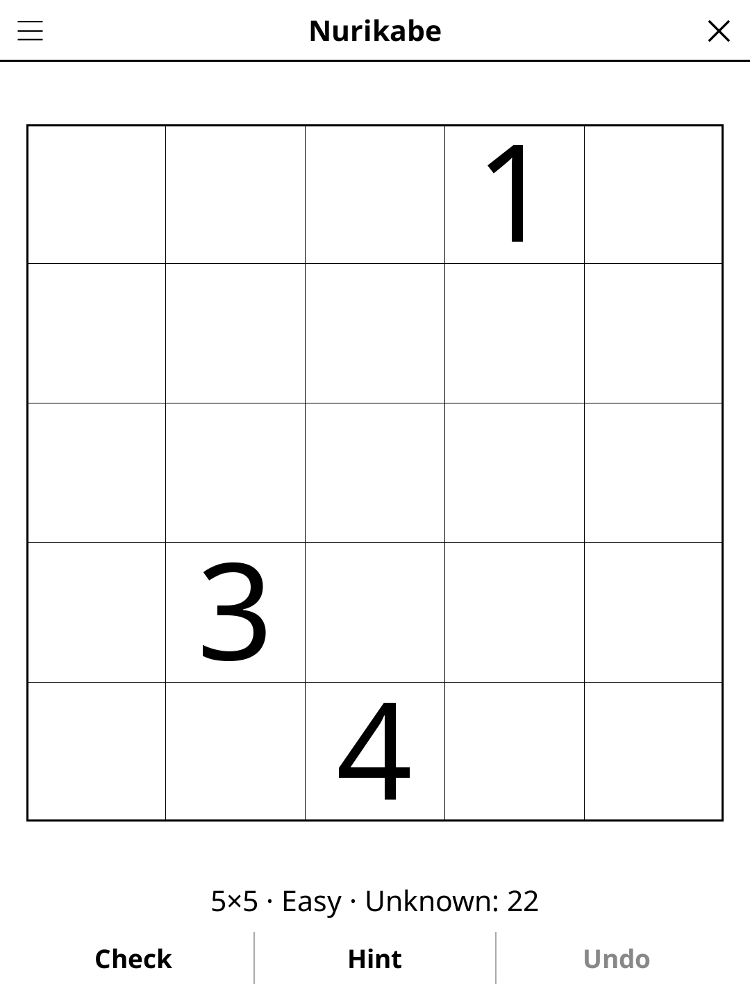

# nurikabe.koplugin

A Nurikabe plugin for [KOReader](https://github.com/koreader/koreader).

## Screenshot

## Rules

Paint cells black (river) or leave white (islands). Each number seeds an island of exactly that many white cells. All black cells must form one connected group. No 2×2 area may be entirely black. Islands must not touch orthogonally.

## Concept

Nurikabe is a binary determination logic puzzle. Blacken some cells of the grid
to create a "river" (connected sea of black cells) and isolated "islands"
(connected groups of white cells) so that:

1. Each numbered white cell seeds an island of exactly that many white cells.
2. Each island contains exactly one numbered cell.
3. No two islands are orthogonally adjacent.
4. All black cells form a single connected region.
5. No 2×2 block of cells is entirely black.

## Features

- **Multiple grid sizes** — 5×5, 10×10, 15×15
- **Three difficulty levels** — Easy, Medium, Hard
- **Cell states** — unknown, white (island), black (river)
- **Island counter** — shows remaining cells needed for each numbered island
- **Check** — highlights violations of each rule
- **Hint** — two taps: the first says which cell is about to give, the second acts on it. A cell that contradicts the solution is always reported before a fresh one is revealed
- **Reveal solution** — shows the full solution
- **Undo** — step back through your moves
- **Auto-save** — game state saved and restored on next launch

## Controls

| Action | How |
|--------|-----|
| Blacken a cell | Tap it (in black mode) |
| Mark a cell as white (island) | Tap it (in white mode) or long-press |
| Toggle black / white mode | Tap the **Mode** button |
| Undo last move | Tap **Undo** |
| Check progress | Tap **Check** |
| New game | Tap **New game** |
| Change grid size | Tap **Size** |
| Change difficulty | Tap **Difficulty** |
| Show rules | Tap **Rules** |

## Why e-ink friendly?

Binary black/white cell states are perfectly matched to e-ink display
characteristics. No animation or colour is required.

## Puzzle generation

Every puzzle, at every size and difficulty, has exactly one solution and can
be solved by deduction alone, without guessing. The difficulty sets the
deepest reasoning a puzzle needs:

- **Easy** — the basic rules: cells next to two islands or a finished
  island are river, the last free cell of a 2×2 river block is island, an
  island or a piece of river with only one way out takes it, cells no
  island can reach are river.
- **Medium** — also cells the river must pass through to stay connected,
  and the ways an island one or two cells short can end.
- **Hard** — the ways a bigger island can end; islands up to 9 cells.

## License

GPL-3.0
